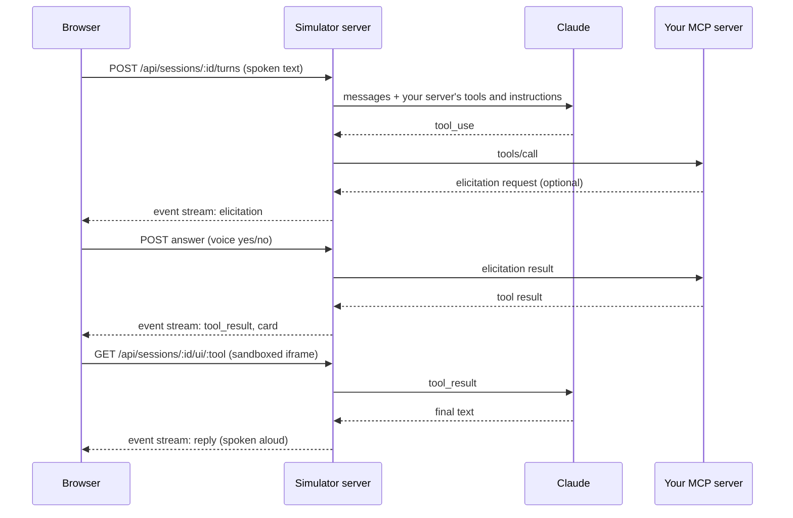

# alexa-plus-sim

A voice and smart-display simulator for testing Alexa+ style MCP servers. Point it at any Streamable HTTP MCP server, talk to it out loud, watch its MCP Apps cards render on a simulated screen, and answer its confirmation prompts by saying "yes" or "no".

Testing an Alexa+ MCP server today usually means MCP Inspector: you pick a tool, fill in a JSON form and read a JSON reply. That tells you the server works, but not whether it works as a conversation. alexa-plus-sim closes that gap: Claude plays the assistant, your server's tools and instructions drive it, and you hear the result the way a user would.

Built during the Build, Ship, Shape: Amazon Developer Hackathon as the open-source companion to [Kin](https://github.com/AlgoMasterArpit/kin_Alexa-), an Alexa+ MCP server for parents who live alone.

## Features

- **Any Streamable HTTP MCP server**, with an optional bearer token.
- **Both protocol eras.** Auto mode probes for MCP 2026-07-28 and falls back to 2025-11-25; you can also pin 2025-11-25 to test exactly what Alexa+ era clients send. The negotiated version is shown on screen.
- **Voice in and out.** Browser speech recognition for input, speech synthesis for replies, plus a text box for quiet testing.
- **Claude as the assistant**, on Amazon Bedrock or the Anthropic API. The server's own `instructions` are added to the system prompt, so you test the prompt your server really ships.
- **MCP Apps.** Tools that declare `_meta.ui.resourceUri` render their `ui://` view in a sandboxed iframe through the official `AppBridge`, with tool input, tool results and host theme delivered over the MCP Apps protocol. Views can call server tools back through the simulator.
- **Elicitation.** `elicitation/create` requests (2025-11-25) and `input_required` results (2026-07-28) both become an on-screen prompt. A single yes/no field is spoken aloud and answered by voice; other schemas render as a form.
- **Activity log** of every tool call and result, so you can see what the model did.

## Quick start

Requirements: Node.js 24 or newer and access to Claude on Amazon Bedrock or the Anthropic API.

```bash
git clone https://github.com/AlgoMasterArpit/alexa-plus-sim.git
cd alexa-plus-sim
npm install
cp .env.example .env
npm run dev
```

Open `http://127.0.0.1:8788`, enter your server's MCP URL (for example `http://127.0.0.1:8787/mcp`), connect, and press the microphone button or Space to talk. Speech recognition works in Chromium-based browsers; every browser can use the text box.

### Model access

- **Amazon Bedrock (default):** credentials come from the standard AWS chain (`aws configure`, environment variables or a role). The identity needs permission for `bedrock-mantle:CreateInference` in `BEDROCK_REGION`.
- **Anthropic API:** set `SIM_LLM_PROVIDER=anthropic` and `ANTHROPIC_API_KEY`.

### Try it with Kin

```bash
git clone https://github.com/AlgoMasterArpit/kin_Alexa-.git kin
cd kin && npm install && npm run build:ui && npm run seed:demo && npm run dev
```

Then connect the simulator to `http://127.0.0.1:8787/mcp` and say "What's on my plan today?".

## Configuration

| Variable                 | Default          | Purpose                                                |
| ------------------------ | ---------------- | ------------------------------------------------------ |
| `PORT`                   | `8788`           | Web UI port. The simulator only binds to loopback.     |
| `SIM_LLM_PROVIDER`       | `bedrock`        | `bedrock` or `anthropic`.                              |
| `SIM_MODEL`              | provider default | Model ID, e.g. `anthropic.claude-opus-5-5` on Bedrock. |
| `SIM_EFFORT`             | `low`            | Claude effort level; low keeps spoken replies fast.    |
| `BEDROCK_REGION`         | `us-east-1`      | AWS region for Bedrock.                                |
| `SIM_DEFAULT_SERVER_URL` |                  | Prefills the connect form.                             |
| `LOG_LEVEL`              | `info`           | pino log level.                                        |

## How it works



- `src/` is the Node server: one MCP client and one Claude conversation per browser session (`sessions.ts`, `agent.ts`), an elicitation broker that parks server questions until the browser answers (`elicitations.ts`), and a small HTTP API with a server-sent event stream for each turn (`http/`).
- `web/` is the browser app: the device screen, speech (`speech.ts`), the MCP Apps host (`card-host.ts`) and the confirmation dialog (`confirm.ts`).
- MCP Apps views are served from their own route with a locked-down Content Security Policy and loaded into an iframe with `sandbox="allow-scripts"`, so a view cannot reach the simulator page or its session.

## Development

```bash
npm run check   # typecheck, lint, format check and tests
npm test        # unit tests plus end-to-end tests against a live MCP server
npm run build   # compile the server and bundle the web app
```

The end-to-end tests start a real MCP server with a plain tool, an elicitation tool and an MCP Apps tool, and drive the simulator against it with a scripted model, so they run without cloud credentials.

## Security notes

The simulator is a local development tool. It binds only to loopback, keeps bearer tokens in memory for the life of a session, never echoes them back to the browser and redacts them from logs. It connects to whatever MCP URL you give it, so only run it on a machine you trust.

## License

[MIT](LICENSE)
